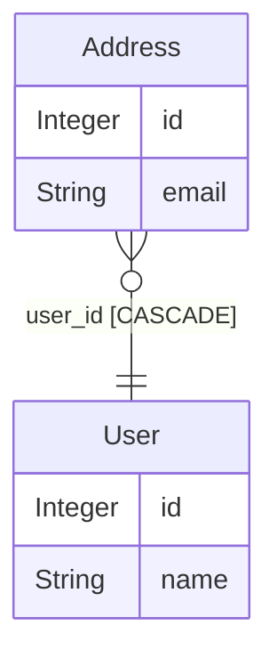

# SQLAlchemy models (preview)

`scan`, `list`, `describe`, `hover`, `er` and `nplusone` read SQLAlchemy models as well as Django ones, and so do the MCP tools `list_apps`, `list_models`, `describe_model`, `find_relations`, `er_diagram` and `nplusone_scan`. Like everything else in the package it is static: files are parsed with `ast`, nothing is imported, no database is touched. Projects that use SQLAlchemy without Django (FastAPI, Flask, Litestar) work with no configuration.

The Django analyses (`drift`, `blast-radius`, `cascade`, `signals`, `suggest-indexes`, `migration-deps`) stay Django-only and never see a SQLAlchemy model. Alembic revisions are covered by [`migration-risk`](alembic.md).

## What is recognised

Any `.py` file in the workspace is read, except tests, virtualenvs, `site-packages`, `migrations/` and Alembic `versions/` directories (old revisions often declare throwaway copies of the models for data migrations).

| Style | Mapped when |
|---|---|
| SQLAlchemy 2.0 | the class descends from `class Base(DeclarativeBase)` (or `DeclarativeBaseNoMeta`, with `AsyncAttrs` / `MappedAsDataclass` mixed in) |
| SQLAlchemy 1.x | it descends from `Base = declarative_base()`, `registry().generate_base()` or an `@as_declarative()` class, or carries `@mapper_registry.mapped` |
| Flask-SQLAlchemy | it descends from `db.Model`, where `db = SQLAlchemy()`; Flask-AppBuilder's `Model` too |
| SQLModel | it is declared with `table=True`; other `SQLModel` classes only lend their fields |

Bases are followed across files by import, including an aliased import from a file with no SQLAlchemy in it (`from core.models import Dashboard as CoreDashboard`). `__abstract__ = True` classes, mixins and the declarative base itself lend their columns to every mapped subclass. A subclass of a mapped class is single-table inheritance when it declares no table and no primary key of its own, and joined inheritance otherwise.

**Table names** come from `__tablename__`, `__table__ = Table("name", ...)`, a `@declared_attr` `__tablename__` on a base (`cls.__name__.lower()` or a snake_case conversion), Flask-SQLAlchemy's automatic snake_case name, or SQLModel's lowercase class name.

**Columns** are `Mapped[...]` attributes with or without `mapped_column(...)`, `Column(...)` / `db.Column(...)`, `deferred(...)`, SQLModel `Field(...)`, and `Annotated` aliases such as `intpk = Annotated[int, mapped_column(primary_key=True)]`. The type is the explicit SQLAlchemy type (`String(50)` → `String`) or the annotation's (`int` → `Integer`, `datetime` → `DateTime`, `UUID` → `Uuid`). A column with `ForeignKey("table.col")` (or SQLModel's `foreign_key=`, or a single-column `ForeignKeyConstraint` in `__table_args__`) is a relation to the class mapped to that table: `ForeignKey`, or `OneToOneField` when the column is unique or the primary key, with `ondelete=` as its delete policy.

**Relationships** (`relationship()`, `db.relationship()`, SQLModel `Relationship()`, and `@declared_attr` functions returning one) are listed apart from the columns, with their target, `lazy` loader, and whether they hold one object or many. The shape comes from the annotation (`Mapped[list["Post"]]`), `uselist=`, `secondary=`, `remote_side=`, `foreign_keys=`, or which side holds the foreign key. A `backref=` adds the attribute on the other class. A relationship with `secondary=` is a many-to-many: it also appears in the model's fields as a `ManyToManyField` through the association table, once even when both sides declare it.

`orm-lens scan --format json` marks these models with `"orm": "sqlalchemy"` and adds `tableName`, `inheritedFields` and `relationships`. Django models serialize exactly as before.

## ER diagrams

`orm-lens er` draws SQLAlchemy models in every format (Mermaid, DBML, D2, PlantUML, Graphviz). Each table shows all of its columns, the ones from mixins and abstract bases included; edges are the foreign keys, plus one per many-to-many.



## N+1 in loops

`orm-lens nplusone` reports a loop over query results that reads a lazily loaded relationship of each row: one query for the list, then one per row.

```python
users = session.scalars(select(User)).all()
for user in users:
    print(len(user.addresses))  # one SELECT per user
```

```text
app/views.py:12  [high]  loop=user qs=users
  accessed: addresses
  fix:      .options(selectinload(User.addresses))
```

**Query shapes followed**, within one function: `select(User)` passed to `session.scalars(...)` or `session.execute(...).scalars()`, `await` and `.all()` / `.unique().all()` included, also through a variable (`stmt = select(User)`, `stmt = stmt.where(...)`); the legacy `session.query(User)`; Flask-SQLAlchemy's `User.query`, `db.paginate(...)` and `.paginate(...).items`; `for user, post in session.execute(select(User, Post))`; a single object from `session.get(User, pk)`, `.first()` or `.scalar_one()` whose collection is looped over; nested loops and comprehensions.

**Counted as loaded:** a relationship named in `.options(...)` with `selectinload`, `joinedload`, `subqueryload`, `immediateload`, `contains_eager`, `raiseload` or `noload`, chained (`joinedload(Post.author).selectinload(User.posts)`), after `defaultload(...)`, through `Load(User)`, as a string path, or by a `"*"` wildcard. A relationship configured with `lazy="selectin"`, `"joined"`, `"subquery"` or `"immediate"` never loads per row. `lazy="raise"`, `"raise_on_sql"`, `"noload"`, `"dynamic"` and `"write_only"` are not reported either. In a nested loop over `user.posts`, `post.author` is the user already in hand.

**Confidence:** `high` when a collection loads per row; `medium` for a many-to-one, which the identity map can answer without SQL when the related object is already in the session.

**Fix:** `selectinload` for collections, `joinedload` for single objects, on the query that produced the rows; for a nested loop the path starts at the outer query (`selectinload(User.posts).selectinload(Post.comments)`).

**Deliberately left alone,** so the detector does not guess: `.options(*opts)` or a helper call it cannot read, a query rebound inside a loop (`stmt = f.apply(stmt)`), queries returned from other functions, writes (`user.posts = []`, `del user.profile`), method calls on the row, columns, test modules (unless `--include-tests`) and Alembic revisions. In a workspace with SQLAlchemy models and no Django ones, the Django detector does not run, so a SQLAlchemy loop never gets `select_related` advice.

Under `AsyncSession` a lazy load does not issue a query: it raises `MissingGreenlet`. The finding and its fix are the same.

## Limits

- Imperative mappings (`registry.map_imperatively`) and classes mapped to a `select()` are skipped or have no table name.
- Composite foreign keys (`ForeignKeyConstraint` over several columns) are not drawn.
- Standalone `Table(...)` objects appear only as the association table of a many-to-many.
- The N+1 detector does not follow a query through a repository method or into another module.
